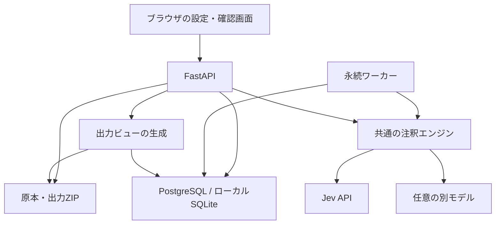

# Jev Dataset Studio

**既存の文章データを投入し、「どこに・何の特徴を付け・どう並べるか」を画面で設定して、学習用データセットを作るWebアプリです。**

CSV・JSONLなどを取り込み、Jevで分類、複数ラベル、条件判定、重要度を付与します。原文の位置、判定に使った文脈、モデル、確認履歴を残し、用途ごとに列と行の単位を変えて出力できます。設定にはフォームを使い、通常の操作にプログラムやYAMLの記述は必要ありません。

APIキーなしでも、架空の日本語サンプルと**デモ判定器**で一連の操作を試せます。デモ値は決定的な合成値で、文章の意味を評価した結果ではありません。すべて「要確認」から始まり、Jevによる判定とは明確に分かれます。

## 起動

### Docker Compose

Docker EngineとDocker Compose **2.24以降**を用意してください。CPUで動作します。Jevの推論は外部APIで実行するため、このアプリにGPUは不要です。

```bash
git clone https://github.com/Unjuno/jev-dataset-studio.git
cd jev-dataset-studio
docker compose up --build -d
```

ブラウザで **http://localhost:8000** を開きます。Web、ワーカー、PostgreSQLが起動します。ポートは既定でlocalhostにのみ公開します。初回のイメージ作成にはネットワーク接続が必要です。

実際にJevを使う場合は、`.env.example`を`.env`にコピーして `TYPESAFE_API_KEY` を設定し、`docker compose up -d` で設定を反映します。画面の判定器で「Jev」を選びます。キーはサーバー側に置き、画面や出力ファイルには含めません。

```bash
cp .env.example .env
# エディタで .env の TYPESAFE_API_KEY を設定
docker compose up -d
```

停止は `docker compose down` です。名前付きボリュームにデータが残ります。**`docker compose down -v` はデータも削除するため、通常の停止には使わないでください。**

### Pythonだけで起動

Python **3.12**で検証する構成です。ローカルのSQLiteと1ワーカーを使います。

```bash
python3.12 -m venv .venv
source .venv/bin/activate
python -m pip install -c requirements.lock .
jev-studio serve --with-worker
```

`.env`を読むのはComposeです。Pythonで直接起動する場合は、必要な値をプロセスの環境変数として設定してください。データの保存先は既定でカレントディレクトリの `data/` です。

## 使い方

1. **データ投入** — ファイルを選ぶか、サンプルデータを読み込みます。本文列、ID列、同じ文書・装置・患者などをまとめるグループ列を指定します。
2. **対象と注釈を設計** — 文書、文、段落、指定した語句、正規表現から対象を選び、ラベルや特徴の定義を追加します。文脈の範囲と、保留にする条件も設定します。
3. **プレビュー** — 原文のハイライト、特徴の値、要確認の理由を確認します。プレビューにも、選択した判定器のAPI呼出しが発生します。デモなら外部呼出しはありません。
4. **全件実行と確認** — ジョブを実行し、必要な項目を修正・承認・除外します。一時停止、再開、失敗行の再試行ができます。
5. **出力** — 行の単位、列名・順序・役割、採用条件、形式、学習用分割を選び、ZIPを取得します。**列や形式を変えるだけなら、モデルの再実行は発生しません。**

たとえば設備点検メモから「現象」「異常が確認されたか」「対応の重要度」を付け、同じ注釈を次のように使い分けられます。

| 用途 | 1行の単位 | 入力列 | 教師ラベル |
|---|---|---|---|
| 文の分類 | 抽出対象 | 対象の文章 | 現象 |
| 語句の特徴分析 | 指定語句の出現箇所 | 語句・本文・位置 | 複数の特徴 |
| 文書単位の分析 | 文書 | 原文 | 対象ごとの特徴の配列 |
| 注釈の比較・集計 | 対象×特徴 | 本文・特徴ID | 特徴の値 |

この製品は**入力文章に根拠を持つ注釈データの構築**を扱います。存在しない事実の補完、自由形式のQA合成、画像や音声の注釈、モデルの学習実行は含みません。

## できること

| 項目 | 実装内容 |
|---|---|
| 入力 | UTF-8のCSV、JSON、JSONL/NDJSON、TXT、Markdown、Parquet。文字列IDと入れ子データを保持 |
| 対象 | 文書・文・段落・文字列の各出現箇所・実行時間制限付き正規表現 |
| 文脈 | 対象だけ・対象文・前後の文字範囲・段落・文書。長すぎる場合は明示的なエラー |
| 特徴 | 単一ラベル、複数ラベル、真偽、不明を含む判定、2〜10段階を定義したスコア |
| 品質条件 | 低確信度、曖昧な真偽、多文脈の不一致、別モデルとの不一致、抜取監査を要確認へ |
| レビュー | 型を検証する編集、承認・除外、競合検知、元の判定と確認履歴の保持 |
| 再利用 | 型付き設定テンプレート、固定版Jevとデモの特徴単位キャッシュ、処理途中からの再開 |
| 出力 | JSONL・CSV・Parquet。文書／対象／対象×特徴、独自の列名・順序・入力/教師/メタデータ/グループの役割 |
| 学習用分割 | 同じグループと完全一致の本文を同じ分割に固定。比率とseedを指定 |
| 実行 | 永続SQLジョブ、ワーカーのリースと結果の二重保存防止、回数上限、費用の概算上限 |

### 品質表示の読み方

**採用は正解の保証ではありません。** 自動採用、要確認、除外、人が確認したか、デモか実モデルかを別の属性として記録します。Jevの確信度やモデル同士の一致を、そのまま正解率とは表示しません。

真偽の不明は `null`、否定は `false` です。複数ラベルで該当なしと判断した場合の空配列と、不明の `null` も区別します。API失敗は処理エラーであり、否定ラベルに置き換えません。候補がゼロの行も、正しい負例だとは扱いません。人が承認するときは不明値の解消が必要です。

判定条件を増やすと、要確認の件数、費用、待ち時間も増えます。品質が改善したかは、用途に合った人手の正解データで検証してください。詳しくは [判定と出力の仕様](docs/SEMANTICS.md) を参照してください。

## 出力ZIP

```text
dataset.jsonl                 # またはCSV / Parquet、分割時はtrain/validation/test
provenance.jsonl              # 出力行→原文→対象位置→各判定→レビュー版
reviews.jsonl                 # 人による変更履歴
recipe.json                  # このジョブの固定された注釈設定
manifest.json                # 出力設定、版、件数、モデル、ハッシュ、処理状況
```

文書単位の出力では、対象に付く値は常に配列です。対象が1件でも配列、明示的に含めた対象なしの文書は空配列になります。CSVでは配列・辞書をJSON文字列として保存します。CSVの数式開始文字を持つ文字列には既定でアポストロフィを付け、表計算ソフトでの解釈を避けます。原文は変更しません。

学習用には、確認状況を見て「確認済みのみ」または「採用済み」を選びます。「すべて」には要確認・除外・デモも含まれます。生成されたデータの利用条件は、入力データとモデルサービスの条件にも依存します。本リポジトリのMITライセンスが入力データの権利を変更することはありません。

## アーキテクチャ



Webとワーカーは**同じPythonコードと同じDockerイメージ**を使います。ブラウザはビルド不要のJavaScript/CSSで、外部CDNやフォント配信に依存しません。ジョブ、注釈、キャッシュ、レビューはSQLに保存し、Redisや別のワークフロー基盤を必須にしません。

SQLiteはローカルの1ワーカー用です。複数ワーカーにはComposeのPostgreSQL構成を使います。サービス規模に応じたSaaSのアカウント管理、課金、複数ホストのファイル共有は別途必要です。

- [実装のインターフェース](docs/API_CONTRACT.md)
- [判定と出力の仕様](docs/SEMANTICS.md)
- [運用・バックアップ](docs/OPERATIONS.md)
- [設計の背景と要件](docs/ARCHITECTURE.md)
- [検証記録](docs/VERIFICATION.md)

## サーバー設定

| 環境変数 | 用途 |
|---|---|
| `TYPESAFE_API_KEY` | Jevの認証情報 |
| `JEV_MODEL` | 初期選択するモデル。既定は固定版 `jev-1.14.0` |
| `VERIFIER_API_KEY`, `VERIFIER_BASE_URL`, `VERIFIER_MODEL` | 任意の別モデル。HTTPSのChat Completionsと厳格なJSON Schema出力に対応したサービス |
| `STUDIO_ACCESS_TOKENS` | `{"workspace-name":"24文字以上のランダムなトークン"}` というワークスペース別の設定 |
| `STUDIO_ALLOWED_HOSTS` | 接続を許可するホスト名。カンマ区切り |
| `STUDIO_SECURE_COOKIES` | TLSで共有する場合は `true` |
| `DATABASE_URL`, `STUDIO_DATA_DIR` | DBとファイル保存先。Composeは自動設定 |
| `JEV_INPUT_PRICE_PER_MILLION`, `VERIFIER_PRICE_PER_MILLION` | 費用計画用の単価。契約価格に合わせて変更 |

既定は信頼できる利用者がlocalhostで使う単一ワークスペースです。共有する場合は、ワークスペーストークン、TLS、許可ホストを設定してください。認証トークンはブラウザのlocalStorageには保存しません。入力に個人情報や秘密情報がある場合、Jevや検証器に送信してよい範囲を設定してください。

費用表示はUTF-8バイト数による概算です。実際の請求額ではなく、課金の厳密な上限にもなりません。別モデルの出力料金なども自動取得しません。リクエスト回数上限は、再試行を含むアプリ側の呼出し試行数を制限します。

## 開発とテスト

```bash
python -m pip install -c requirements.lock '.[dev]'
ruff check studio tests
node --check studio/static/app.js
node --test tests/review_filter.cjs
pytest -q
```

`requirements.lock` は検証環境で固定した依存バージョンです。CIはPythonテスト、PostgreSQLでの並列ワーカー検証、JavaScriptの構文検査、Docker Composeでの起動・実行・出力を検査します。`TEST_DATABASE_URL` を指定しないローカル実行ではPostgreSQLのテストのみスキップします。外部の有料APIをテストから呼びません。

JevのHTTP契約は [System One](https://docs.typesafe.ai/api/system-one)、[Choice](https://docs.typesafe.ai/primitives/choice)、[Noul](https://docs.typesafe.ai/primitives/noul)、[Score](https://docs.typesafe.ai/primitives/score) に基づき、HTTPフィクスチャで検証します。実際のモデルの精度・校正・料金・応答時間の保証とは分けています。

## English

Jev Dataset Studio turns existing text datasets into configurable annotation datasets. Upload data, choose spans and context, define typed features, preview, run durable jobs, review uncertain labels, and export custom dataset views. The browser workflow does not require writing code or YAML.

The live provider is Jev. An explicitly labelled deterministic demo runs without credentials; its labels are synthetic and always require review. Original Unicode spans, model predictions, review history, and export snapshots are preserved. Exporting different columns or formats does not call a model.

Run `docker compose up --build -d` and open http://localhost:8000. For real inference, copy `.env.example` to `.env`, set `TYPESAFE_API_KEY`, recreate the services, and select Jev in the UI. The application uses one image for the web process and worker, PostgreSQL for Compose, and SQLite for single-worker local use. No GPU or frontend build step is required.

Automated acceptance and model agreement are **not measured accuracy**. Evaluate labels against human references for your own task. Demo provenance remains visible even after review. The input dataset and model-provider terms govern your use of the produced data separately from this software's MIT license.

## License

[MIT](LICENSE). This is an independent project, not an official TypeSafe product.
