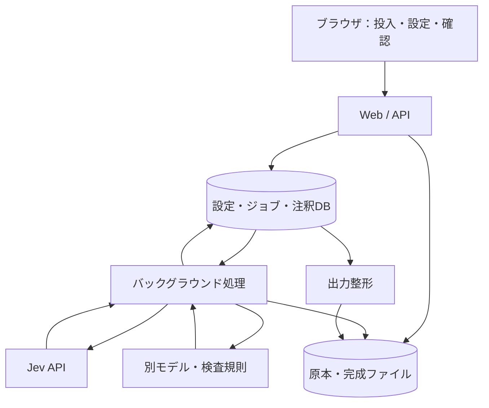

# Jev Dataset Studio — アーキテクチャ・要件定義案 v1.0

作成日：2026-11-25（利用者のタイムゾーン）  
文書種別：完成形の設計提案。実装完了報告・実測性能報告ではない。

本書は設計の背景を保存した文書です。現在の動作仕様、対応範囲、起動方法は [README](../README.md)、[判定と出力の仕様](SEMANTICS.md)、[検証記録](VERIFICATION.md) を参照してください。

## 1. 結論と目的

**既存データを投入し、画面で「どこに・何の注釈を・どの条件で付け・どう並べて出すか」を設定すると、Jevを中心に特徴抽出・ラベル付け・重要箇所のマーキングを実行し、学習用データセットを返す製品を作る。**

推奨構成は、専用の短い設定画面、共通の注釈実行エンジン、永続ジョブ、注釈ストア、出力整形器を持つモジュール化された一つのアプリケーションである。完成形の機能範囲を扱い、開発段階による機能制限は置かない。

設計の中心は、次の分離である。

- 元データの不変スナップショット。
- 原文中の対象と、その対象に付く注釈。
- 採用・保留・人による確認の記録。
- 利用目的ごとの出力ビュー。

これにより、ラベルを追加する、注釈基準を変更する、文書単位と語句単位を切り替える、CSVとJSONLを出し分ける、といった操作を一つの製品で扱える。

### 1.1 調査事実・設計判断・未検証事項

| 区分 | 内容 |
|---|---|
| 確認した事実 | JevはChoice、Noul、Scoreで型の決まった判定を返す。公式には候補を先にコードで抽出し、Jevで選択する例がある。[S1–S5] |
| 設計判断 | 対象位置はコードで管理し、意味的な特徴付与をJevに担わせる。出力の変更と推論の変更を分離する。 |
| 検証すべき仮説 | 多文脈・異種モデル・規則の組合せにより、許容費用と採用量を保ちながらラベルの誤りを減らせる。 |
| 未検証 | Jevの対象ドメインでの精度・校正・遅延、利用者の操作時間、処理可能な最大規模、フィルタ追加による実際の改善量。 |

## 2. 利用体験

利用者の操作は「投入 → 設計 → プレビュー・実行 → 取得」に統一する。プログラム、YAML、APIの実装を利用者に要求しない。管理者が一度接続設定したサービスを、利用者はブラウザから使う。

### 2.1 設計画面で決める項目

| 項目 | 操作 | システムが確認すること |
|---|---|---|
| データ | ファイル投入、本文列・ID列の選択 | 文字コード、列、欠損、ID重複、原本の版 |
| 対象 | 文書・文・句・語句の出現箇所・範囲を選択 | 対象の粒度、原文位置、全件への適用方法 |
| 注釈 | 単一ラベル、複数ラベル、条件、重要度などを追加 | 型、許容値、判定目的、曖昧な場合の扱い |
| 文脈 | 対象文・前後文・段落・文書などを指定 | 送信される本文範囲、最大長、時点・主体の範囲 |
| 確認方法 | 規則、別文脈、別モデル、抜取確認を選択 | 適用条件、追加コスト、採用・保留の条件 |
| 出力 | 1行の単位、列名・列順、列の役割、形式を設定 | 複数対象の扱い、型変換、学習用分割 |

既定値と用途テンプレートを用意し、全項目の手入力を毎回求めない。詳細な型定義とリクエスト構築はアプリが行う。

### 2.2 一つの例を選んだときの意味を明示する

ユーザーが文章中の「異常振動」をドラッグしただけでは、次のどれをしたいのか確定しない。

- この箇所だけに注釈を付ける。
- 全文書で同じ文字列を探す。
- 「故障兆候」に該当する異なる表現も探す。

選択直後に適用方法を選べるようにする。意味による探索では、対象となる文・句の候補と判定基準を確認できるようにする。一例の選択だけで未知の意図を正しく学習したとは表示しない。

### 2.3 自然言語の扱い

型・選択肢・処理手順・範囲・出力の構成は固定フォームで指定する。意味定義には、ラベルの短い説明、正例、反例、境界例を用いる。

「重要度：高」だけでは、何に対して重要か決まらない。たとえば「設備の点検判断への影響」を目的として選び、各段階の意味を設定する。説明文は版管理された判定基準の一部となり、実行時の任意の操作指示にはしない。

### 2.4 三つのプレビューを一画面に置く

1. 原文と候補のハイライト。
2. 特徴・ラベル・保留理由。
3. 完成するデータセットの表。

加えて、対象件数、候補がゼロの文書、推定呼出量、費用見積り、失敗を表示する。プレビューと全件処理は同じ設定版・同じ処理モジュールを使用する。

## 3. 中核データモデル

内部では「元データ＋注釈」を保持し、最終的な学習形式は出力時に作る。これが独自の列構造と多様な学習用途への対応を簡単にする。

| オブジェクト | 保持するもの | 必要な理由 |
|---|---|---|
| DatasetRevision | 原本、ハッシュ、本文、原行ID、解析器の版、グループID | 原文を固定し、処理と出典を追跡する |
| RecipeRevision | 対象規則、特徴定義、文脈、モデル、検査・採用規則 | 全件処理と再利用で同じ条件を使用する |
| Target | 原文ID、範囲・文IDなどのselector、候補生成方法 | 注釈を「どの箇所」に付けたか明示する |
| Prediction | 対象ID、特徴ID、値、分布、モデル、文脈、証拠参照 | 各判定器の結果を混ぜずに残す |
| AnnotationDecision | 最終的に使う値、由来、採用判断、検証記録 | フィルタ統合の結果と根拠を残す |
| Review | 人による修正・確認、確認者、時点 | モデル予測を上書きせず人の判断を追加する |
| Run / WorkItem | ジョブ版、処理単位、再試行、進捗、費用 | ブラウザ終了や障害後も処理を再開する |
| ExportSnapshot | 出力配置、含めた注釈版、分割、ハッシュ、集計 | 完成したデータセットを再現・共有する |

名称は設計上のもので、各オブジェクトが独立したサービスを意味するわけではない。

### 3.1 任意性を支える固定部品

- **対象型**：文書、文、文字範囲、範囲の集合、対象間の関係。媒体に応じたselectorを登録できる。
- **値型**：単一カテゴリ、複数カテゴリ、真偽、順序尺度、数値、文字列、配列・レコード。
- **意味定義**：何を判定するか、許容する根拠、正例・反例・曖昧例。
- **出力ビュー**：対象ごと、文書ごと、注釈ごとの行構成と集約方法。

新しい特徴名やラベルを追加するたびに開発者がコードを書く必要はない。一方、新しい媒体の座標系や未対応の処理能力は、入力・対象・モデル・出力の適切なアダプターを必要とする。「任意の型を定義できる」と「全媒体を無条件に処理できる」は区別する。

JSON Schemaは値の型、必須フィールド、許容値、余分なキーを制御する内部契約に使用できる。意味的な正しさや別フィールドを跨ぐ原文位置整合は専用検査で扱う。[S9]

### 3.2 出力粒度を必須設定にする

| 1行の単位 | 出力例 | 複数の対象がある場合 |
|---|---|---|
| 文書 | 本文、文書カテゴリ、対象一覧 | 注釈を配列に保持するか、明示した集約を使う |
| 対象箇所 | 対象語句、開始・終了位置、特徴列 | 一つの出現箇所ごとに行を作る |
| 注釈 | 対象ID、特徴名、値 | 同じ対象に複数行を作る |

CSVで配列を扱う場合は、行展開・固定列展開・明示的シリアライズのどれかを設定する。自動的に先頭だけを選んだり、残りの注釈を捨てたりしない。

列順・列名・保存形式を変更するだけなら、注釈結果を再利用する。モデルの再呼出はしない。特徴の定義を変更した場合は、その特徴と依存する判定だけを再計算する。

## 4. Jevの使い方

### 4.1 注釈とAPIの対応

| 注釈 | Jevの利用 | 注意点 |
|---|---|---|
| 単一カテゴリ | Choice | 排他的な選択肢。該当なし・情報不足を必要に応じて定義 |
| 複数カテゴリ | ラベルごとのNoulなど | 単一Choiceの確率分布を独立した複数ラベルと解釈しない |
| 条件成立・関連性の有無 | Noul | 返るのはyesのモデル確率。閾値で採用・不採用・保留を分ける |
| 重要度・程度 | Score | 段階ごとの意味を定義。返却値は中間値も取り得る |
| 重要箇所 | 候補ごとの判定＋原文selector | 位置は候補IDから復元。複数箇所を単一Choiceだけで拾い切ろうとしない |
| 正確な数値・文字列 | 候補からの選択＋原文コピー・確定的変換 | Scoreを数値測定や数字の転記の代替にしない |

以上の対応は公式プリミティブ仕様と候補選択のcookbookに基づく。[S1–S5] この設計の文字マーキングは、画像のBox座標を文章の文字位置として用いない。

### 4.2 候補を見つける処理と特徴付与を分ける

候補生成には、入力全体の文・句の分割、文字列・辞書・規則による抽出、候補を見つけるモデル等を使用する。出力対象の粒度に応じて選択する。意味で重要箇所を探す設定でも、既知のキーワードがあることを必須にしない。

候補には原文位置と安定したIDを付ける。Jevは、その候補と指定文脈について特徴を判定する。Jevの選択結果から、原文の文字列と位置をコードで取得する。公式資料も、事前抽出した候補を選ばせる方式と行IDによる検索を示している。[S5–S6]

**論理上の制約と証明：** 後段が候補の選別だけを行う場合、最終出力の対象はすべて候補集合に含まれる。元文章の正しい対象が候補集合に含まれなければ、最終出力にも含まれない。したがって後段フィルタの追加だけでは、その取りこぼしは回復しない。これを改善するには、候補生成の改善か、別経路による追加候補探索が必要である。

### 4.3 原文位置の契約

- 本文の基準版を固定し、半開区間の開始・終了位置で管理する。
- 単位はUnicodeコードポイント。ブラウザで得たUTF-16の位置やUTF-8バイト位置からは明示的に変換する。
- 原文と解析用テキストを分ける場合は対応表を保持する。対応不能な正規化をした後で原文位置を推測しない。
- 対象文字列、原文ID、範囲を合わせて保存し、出力時に再照合する。
- トークン単位の出力にはトークナイザー名・版とコードポイント範囲への対応を保存する。重なりスパンをBIO等に変換できない場合は設定エラーとして説明する。

位置と引用文字列による注釈はW3C Web Annotationのselector設計も参考になる。[S8]

#### 位置例と変数表

原文「装置Aで異常振動が報告された。」では、開始位置4、終了位置8が「異常振動」を表す。これは説明用の例であり、Jevの実行結果ではない。

| 記号・項目 | 意味（日本語） | SI単位 | 定義 | 範囲・前提 | 型 |
|---|---|---|---|---|---|
| start | 開始位置 | 物理単位なし、コードポイント数 | 最初の対象文字の0起点位置 | 原文内の非負整数 | 整数スカラー |
| end | 終了位置 | 物理単位なし、コードポイント数 | 最後の対象文字の次の位置 | startより大、原文長以下 | 整数スカラー |
| text | 位置計数の対象本文 | 該当なし | 固定した原文版 | Unicode文字列 | 文字列 |

単位チェック：開始・終了は同じ本文のコードポイント数なので比較可能。例の範囲は4コードポイントで、対象語の長さと一致する。

### 4.4 モデル呼出の条件

同じ文脈への複数特徴は、API上限の範囲で一つのリクエストにまとめられる。Jevは同一stateに対して複数質問を処理する。[S7]

ただし、局所文脈と広域文脈を別条件として比較するなら、実際に異なるstateで呼び出す。同じ全文を渡して質問文だけで「局所を見て」と指示する方式では、情報範囲の分離にならない。

モデルの指定版、実際の返却版、質問・選択肢・順序、文脈、前処理版、応答、usageを保存する。移動するモデル別名は実行版に固定して扱う。公式資料は、別名の更新で結果が変わり得ることと、応答に解決済み版が返ることを説明している。[S7]

## 5. 多重フィルタと品質管理

### 5.1 三つの品質を別に測る

| 品質 | 測定対象 | 主な失敗 |
|---|---|---|
| 候補の網羅性 | 元文章中の正しい対象を候補化できたか | 言い換え・希少表現を拾わない |
| 注釈の正しさ | 範囲・ラベル・特徴が参照正解と合うか | 否定、主体、時点、引用の解釈ミス |
| 学習への有用性 | 独立した評価データ上の下流モデル性能 | 重複、難例除去、ラベル偏り、情報漏洩 |

### 5.2 全件検査と条件付き再判定

全件に型、原文位置、許容ラベル、必須項目、重複・出典の検査を実施する。意味確認は設定に従い、別文脈・別モデル・規則を組み合わせる。高価な再判定の適用条件は、不一致、曖昧さ、重要ラベル、ランダム監査などから設定する。

別モデルには、可能な限りJevの回答を提示せず、対象と原文から判断させる。ただし別モデルでも誤りの独立性は保証されない。判定の統合は、対象ID、特徴ID、対象時点・主体が一致するものに対して行う。

たとえば「異常が報告された」と「翌日の点検で再現しなかった」は、同じ真偽命題への相反する回答ではない。別属性として扱う。

Snorkelの研究は、不完全なラベル付け関数に精度差と相関がある問題を扱う。[S10] この知見は誤り相関を記録・評価する根拠になるが、判定器を増やせば常に良くなるという保証ではない。

既定の統合規則は明示的で説明可能な条件とする。重み付き集約や学習されたラベルモデルを使う場合は、検証データとモデル仮定を別途明示する。未校正の異種モデルスコアを単純平均して、正解確率とは表示しない。

### 5.3 重要度・確信度・品質確認を分離する

Jevのconfidenceは、Choice/Scoreの回答分布から計算される量であり、観測した正解率そのものではない。Noulは独立したconfidence項目を持たない。[S4]

画面と出力では次を区別する。

- 対象の特徴としての重要度。
- モデルの確率分布・confidence。
- 人や独立した参照データによる品質確認結果。

「confidence 0.95」を「95%の正解保証」と表示しない。確率の校正が必要な場合は、用途・特徴・モデル版ごとに独立した評価を行う。校正の一般的な課題はGuoらの研究で整理されている。[S11]

### 5.4 状態を混同しない

| 管理するもの | 例 |
|---|---|
| 注釈の値 | 肯定、否定、記載不明、各ラベル |
| 由来 | モデル、規則、人 |
| 採用判断 | 自動採用、要確認、除外 |
| 人の確認 | 未確認、確認済み、複数者で裁定済み |
| 処理状態 | 待機、実行中、完了、再試行、失敗 |
| 検査結果 | 型整合、位置整合、文脈間一致など |

保留、未処理、API失敗、候補ゼロを自動的に負例へ変換しない。自動採用されたラベルは、モデル由来・人による確認なしという属性を保持したまま学習用に出力可能とする。全件人手確認を必須にしない。

### 5.5 抜取監査と偏りの把握

不一致や難例を優先的に確認する経路と、自動採用された結果をランダムに抽出して監査する経路を分ける。候補化されなかった原文も標本に含める。

レビューしやすい事例だけを評価すると、全体の正解率は推定できない。採用率、除外率、保留率、ラベル分布、ドメイン別の取りこぼしも可視化する。精度と採用範囲の関係はselective predictionの考え方が参考になる。[S12]

## 6. 学習データを壊さない出力

### 6.1 列の役割

各列を「学習入力」「予測対象」「根拠・監査」「分割キー」に区分する。同じJev出力を特徴として使うこと自体を禁止しない。予測対象のコピーや、本番では得られない情報が学習入力に入る場合を検出する。

時点予測では、予測時点に観測できる範囲の文脈を指定する。将来の結果を含む全文から特徴を作れば、本番と異なる条件になる。データ漏洩の評価上の問題はKapoorとNarayananの研究が参考になる。[S13]

### 6.2 データ分割

元文書、同一会話、同一利用者、時系列など、用途に適した分割グループを設定する。関連する元データのグループを確定し、派生した対象や注釈はその分割を継承する。重複原文が別IDで登録されている場合も検出する。

人手で参照注釈を作るデータ、閾値調整データ、最終評価データの役割を分ける。近似重複の検出には漏れと誤検出があり、完全検出を保証しない。

### 6.3 出力物

- 設定した列構造の学習用データ：JSONL、CSV、Parquet等。
- 必要に応じた対象用途向け形式：分類、スパン、トークンタグ、特徴量表など。
- 再現用の情報：原本・設定・モデル・処理の版、出典の対応、分割方式。
- 品質集計：採用・保留・失敗件数、検証状況、ラベル分布、費用。

モデル用ファイルから監査列を外す場合も、安定したIDで別の監査ファイルに結び付ける。重要箇所の重なり、配列、複数の値など、出力先で表現できない情報は黙って捨てず、設定変更を求める。

## 7. ソフトウェア構成

### 7.1 論理アーキテクチャ

バックグラウンド処理の内部で、入力解析、候補生成、文脈生成、Jev呼出、再判定、採用判定を行う。これらは同じコードベース内のモジュールであり、個々のネットワークサービスに分割しない。

### 7.2 推奨する配置

| 要素 | 推奨構成 | 理由 |
|---|---|---|
| 画面とAPI | 一つのWebアプリ | 設定と結果を一貫して表示する |
| 長時間処理 | 同じアプリイメージのworkerプロセス | ブラウザの接続時間に依存しない |
| 状態保存 | PostgreSQL | 設定・注釈・ジョブをトランザクションで管理 |
| 原本・完成物 | 永続ボリュームまたはストレージアダプター | 大きなファイルをDBの状態管理と分離する |
| モデル | Jev APIを主とするプロバイダーアダプター | モデル仕様の変更を製品内の小さな境界に閉じ込める |

標準配布はWeb、worker、DBをまとめたDocker Composeとし、一般利用者向けには同じ製品をホスト済みサービスとして提供できるようにする。管理者の配備と利用者の操作を区別する。

ジョブキューはDBで管理する案を採用する。PostgreSQLの行ロックとSKIP LOCKEDはキュー型の複数consumerに利用できると公式文書に記載される。[S14] 外部APIを呼び出している間はDBトランザクションを開き続けず、期限付きの処理権・heartbeat・再取得で管理する。

本提案では、別のキューサービスや別管理のワークフロー基盤を必須にしない。これは完成形の運用を簡素化する選択であり、必要な機能を後回しにする意味ではない。

### 7.3 実装・運用の前提

- Jevは外部HTTPS APIとして利用する。Jevのモデル本体をコンテナ内に配置できるという前提は置かない。
- アプリ側のGPUを必須条件にしない。別モデルをローカルで動かす配置では、そのモデルの実行環境を別途定義する。
- Web/APIとworkerで設定スキーマ・モデル接続・注釈型を共有し、プレビュー専用の別実装を作らない。
- 依存ライブラリ、アプリイメージ、DB、モデル接続の版は配布時に固定する。ここでは未検証の具体バージョン互換を保証しない。
- 対応最大サイズ・同時実行数・速度・料金は設定可能な上限とし、実測後に公開する。

## 8. 実行の信頼性と費用

### 8.1 再開と冪等性

原文・対象・特徴定義・モデル条件を識別できる処理単位で進捗を保存し、完了済み単位の結果は再利用する。結果の書込みには一意性を持たせ、同じ処理単位の重複した公開を防ぐ。

処理権の期限が切れて別workerに引き継がれた場合は、結果確定時に試行ID・処理権の世代を検査する。旧workerから遅れて届いた応答が、新しい結果を上書きすることを防ぐ。

外部APIが処理を完了した後で通信が切れた場合など、課金を含めたexactly-onceは保証できない。再試行の上限、試行記録、二重呼出の可能性を扱う。429や一時的過負荷には公式に従ったバックオフを使用し、認証失敗や不正設定を無限再試行しない。[S15]

### 8.2 キャッシュキー

キャッシュは単語だけでは識別しない。利用者・権限境界、入力版、対象範囲、実際の文脈、特徴定義と選択肢順、モデル版、推論条件、前処理版を含む。

判定器の生の結果と、採用ポリシーの結果を分ける。閾値や出力ビューだけを変えた場合は、既存の判定から再集計できる。

### 8.3 費用上限

プレビューで得た入力サイズ・呼出条件から見積りを出し、最大同時実行数、最大再試行回数、ジョブの費用枠を設定する。予算の残りが足りない場合は新規呼出を止める。進行中の呼出分を予約枠として扱い、停止後も既に始まった処理の費用が発生することを説明する。

予約額が推定値の場合、これは予算に基づく新規呼出の停止であり、実請求額の厳密上限保証ではない。請求額そのものを保証するには、固定された価格条件とリクエスト単位の費用上界が必要になる。

### 8.4 出力確定

出力開始時に、対象となる注釈IDとその版の一覧、または一貫した読取スナップショットを固定する。出力中に人の修正が入っても、異なる時点の注釈を一つの出力に混ぜない。

ファイルを一時領域で作り、スキーマ・件数・出典を検査した後に完成物として公開する。DB内の出力版は、完成したファイルに対してのみ確定させる。ブラウザには途中ファイルを完成品として出さない。

## 9. 必須要件と受入条件

以下は開発段階の分類ではなく、完成形が満たすべき条件である。

| ID | 要件 | 受入条件 |
|---|---|---|
| U01 | コード不要の一貫した操作 | 利用者がフォーム操作だけで投入から出力まで完了できる |
| U02 | 適用範囲を明示 | 一箇所・文字列全件・意味的候補の適用結果をプレビューできる |
| U03 | 目的と尺度を持つ特徴定義 | 名称だけでなく、基準・例・不明の扱いを保存できる |
| U04 | 行粒度と列役割 | 文書と対象単位を切替でき、複数値の処理を黙って決めない |
| U05 | 設定テンプレート | 定義・例・検査・出力を版付きで再利用できる |
| D01 | 不変原本と来歴 | 任意の出力行から原文版・対象・設定・実行に到達できる |
| D02 | 原文との整合 | 採用する文字範囲が基準本文の対応範囲と完全一致する |
| D03 | 型整合 | 許容外ラベル、不正な数値、必須値不足を採用結果から除く |
| D04 | 複数注釈 | 一対象の複数特徴、一文書の複数対象、重複文字列を識別できる |
| Q01 | 値と状態の分離 | 保留・失敗が負例にならず、自動採用と人の確認を区別できる |
| Q02 | フィルタ記録 | 文脈・判定器別結果と最終採用理由を参照できる |
| Q03 | 監査と分布表示 | ランダム監査、難例確認、元文書の取りこぼし確認を扱える |
| Q04 | 学習用分割 | 指定グループ由来の事例が分割を跨がない。評価用途を追跡できる |
| O01 | 停止・再開 | workerを中断しても完了済み注釈を失わず再開できる |
| O02 | 再試行の境界 | 一時障害は有限再試行し、設定不正と処理不能を表示する |
| O03 | 不要な再推論を避ける | 列順・列名・形式だけの変更でJev呼出が発生しない |
| O04 | 予算管理 | 予約済み処理分を含めた費用管理と新規dispatch停止ができる |
| O05 | 権限と秘密 | APIキーはサーバー側で管理し、他利用者の原文・結果を読めない |
| O06 | 送信範囲の把握 | 外部モデルへ送る列・文脈・送信先を実行前に確認できる |
| O07 | 入力と命令の分離 | 元文章を命令として実行せず、モデルが保存先や処理権限を変更できない |
| E01 | 出力の完全性 | 出力先で表現不能な注釈を失わず、採用・保留・失敗の件数を照合できる |
| E02 | 再生成 | 保存済み注釈から同じ出力設定で同じ内容を再作成できる |

E02は、外部モデルを再呼出して常に同じ回答を得られるという意味ではない。

## 10. 既存ツールを再利用する範囲

Label Studioは注釈画面やモデル予測の取り込みに使えるが、独自の注釈設定はXMLを扱い、独自モデルはML backendの実装が必要となる。[S16] Argillaも型付きの質問やレビューのUIを備える一方、公式のデータセット構成例はSDKによる設定を示している。[S17]

したがって「既存ツールに小さなJevアダプターを付ければ、今回の全操作が既にノーコードで完成する」とは断定しない。

**採用判断：** 製品の設定画面・実行管理・出力設計は一つの専用フローとする。既存の注釈ツールは、予測や修正を安定したIDで入出力するレビュー接続先として利用できる。導入時に既存ツールが十分な要件を満たす場合も、注釈の正本と版管理の責任は一箇所に決め、二重管理を避ける。

## 11. 評価計画

### 11.1 機能の合否

型・位置・出典・停止再開・版管理・分割は、正常系と異常系を含む受入データで確認する。日本語、絵文字、結合文字、同じ語の反復、改行、空データ、複数範囲、過長文書、API失敗を含める。これらの機能検査の通過だけでは、意味的な正解率は証明されない。

### 11.2 品質・使いやすさの検証

| 区分 | 計画 |
|---|---|
| H：反証可能仮説 | 同じ元文書集合・固定モデル版・固定費用条件で、多重フィルタにより採用注釈の誤りを減らし、事前に定めた採用量・対象再現率を満たす。利用者がコードを編集せず所定の出力を完成できる。 |
| T：最小検証 | Jev単独と提案設定を同一入力で比較。モデル回答を見ずに作った参照注釈を使用し、調整用と最終評価用を分ける。対象が候補にならなかった文書も評価する。必要標本数は目標精度、区間幅、希少ラベル、文書内相関から事前に設計する。固定確認時点または妥当な逐次推定を用い、都合のよい時点で止めない。 |
| D：判定 | PASS：機能要件をすべて満たし、注釈精度・採用量・再現率・費用・操作完遂の事前目標を満たす。FAIL：機能違反や品質目標未達が確認された。UNCERTAIN：参照正解・標本が不足するか、区間推定が基準を跨ぐ。 |
| C：破れ方 | 共通の誤り、対象候補の不足、難例と希少ラベルの除外、設定の意味の曖昧さ、出力形式による情報損失、費用超過。 |
| U：不確かさ | 標本誤差、参照注釈者の不一致、文書内相関、ドメイン差、モデル更新。比率の区間推定やグループを保った再標本化を用いる。異質な誤差源を根拠なく合成標準不確かさに加算せず、一律の包含係数も置かない。 |

精度目標を一律98%等に固定しない。許容誤りは学習タスクと用途による。正解データを持たない利用者にも実行・出力は可能とし、品質表示は「未測定」「モデル間一致率」など、計測した内容に限定する。

### 11.3 測定条件と報告

性能を測定する場合は、入力件数・長さ・言語・ラベル分布、Jev実版、質問数、文脈設定、追加モデル、バッチ条件、同時数、ネットワーク条件、ホストCPU/RAM/必要ならGPUを記録する。時間は中央値と上位分位、費用は対象件数と再試行を含む値、意味品質はラベル別・領域別に報告する。現段階では数値ベンチマークを提示しない。

## 12. 応用・転用例

| 分野 | 対象・注釈例 | 学習用出力 |
|---|---|---|
| 自然言語処理 | 人名・対象物・否定・重要箇所 | 分類、NER、スパン注釈 |
| データ工学 | 出典、対象位置、注釈版、欠損 | 再利用可能な特徴量表・追跡可能な変換データ |
| 弱教師あり学習 | 複数判定のモデルラベルと保留 | 由来と品質条件が分かる教師候補 |
| 人間と計算機の相互作用 | 視覚的設定、プレビュー、修正 | 非エンジニアでも再利用できる注釈テンプレート |

### 具体例

元データ：「装置Aで異常振動が報告された。翌日の点検では再現しなかった。」

対象語句を「異常振動」、特徴を「現象種別」「発生報告」「点検での再現」「点検判断への重要度」に設定する。対象語句の位置はコードで保持し、意味はJevで判定する。「発生報告あり」と「点検時には再現なし」は異なる特徴として保存する。

同じ注釈から、語句一件ごとの分類表、原文に位置を持つスパンデータ、文書一件ごとの特徴一覧を出力できる。表現方法を変更するだけならモデルを再実行しない。この例の特徴値は設計説明用で、実際にJevから取得した値ではない。

## 13. 設計上の決定と未決事項

### 採用を推奨する決定

1. Jevによる既存データへの特徴・注釈付与を製品の中心に置く。
2. 対象発見、特徴判定、品質判断、出力整形を別モジュールにする。
3. 原本、予測、採用判断、人の修正を分けて保存する。
4. ユーザーはフォームとテンプレートで設定し、コードを記述しない。
5. 一つのアプリと共通worker、DBの永続ジョブで運用する。
6. 自動採用と全体からの抜取監査を両立し、人の確認を全件必須にしない。
7. 出力行の粒度と列の学習上の役割を明示する。

### 導入環境に合わせて決める事項

接続資格情報の管理主体、同時利用数、データ量、外部送信を許す範囲、保存期間、具体的な品質目標、利用する第二判定器。これらはアーキテクチャを検討するための事前質問とはせず、設定・運用上の可変条件として扱う。

## 14. ERROR CHECK

- 既存のMVPが本設計を実装済みとは主張していない。
- Jevのconfidenceを実測正解率として扱っていない。
- Choiceの排他性、複数重要箇所、重要度と確信度の違いを考慮した。
- 多文脈・多モデルの独立性や精度向上を無条件に仮定していない。
- 文字位置、行粒度、否定と保留、実行失敗、再推論と再エクスポートを区別した。
- 正解率・料金・速度・ユーザーテスト結果は未測定。性能保証を行っていない。
- 設計の完成形を整理したもので、段階的な実装計画へ論点を移していない。

## 15. 次に考える問い

**異なる分野の利用者が同じ画面を使うとき、最も手間がかかるのは「重要な箇所の定義」「ラベルの境界」「完成データの行構造」のどれか。** この答えを実利用者の操作で確かめると、テンプレートとプレビューの重点を決められる。

## 参考資料

2026-11-25に一次資料を確認。文書中の構成・要件は本案件への設計提案であり、各資料が製品全体の実現性・精度を保証するものではない。

- [S1] TypeSafe, [Choice](https://docs.typesafe.ai/primitives/choice).
- [S2] TypeSafe, [Noul](https://docs.typesafe.ai/primitives/noul).
- [S3] TypeSafe, [Score](https://docs.typesafe.ai/primitives/score).
- [S4] TypeSafe, [Confidence](https://docs.typesafe.ai/confidence).
- [S5] TypeSafe, [Pre-parsed value extraction](https://docs.typesafe.ai/cookbooks/pre_parsed_value_extraction_cookbook).
- [S6] TypeSafe, [Line-by-line search](https://docs.typesafe.ai/cookbooks/semantic_find).
- [S7] TypeSafe, [System One API](https://docs.typesafe.ai/api/system-one), [Models](https://docs.typesafe.ai/models).
- [S8] W3C, [Web Annotation Data Model](https://www.w3.org/TR/annotation-model/), 2017.
- [S9] JSON Schema, [Object](https://json-schema.org/understanding-json-schema/reference/object).
- [S10] Ratner et al., [Snorkel: Rapid Training Data Creation with Weak Supervision](https://arxiv.org/abs/1711.10160), arXiv:1711.10160.
- [S11] Guo et al., [On Calibration of Modern Neural Networks](https://proceedings.mlr.press/v70/guo17a.html), ICML 2017.
- [S12] Geifman & El-Yaniv, [SelectiveNet: A Deep Neural Network with an Integrated Reject Option](https://proceedings.mlr.press/v97/geifman19a.html), ICML 2019.
- [S13] Kapoor & Narayanan, [Leakage and the Reproducibility Crisis in ML-based Science](https://arxiv.org/abs/2207.07048), arXiv:2207.07048.
- [S14] PostgreSQL, [SELECT — Locking Clause](https://www.postgresql.org/docs/current/sql-select.html).
- [S15] TypeSafe, [Request rules and errors](https://docs.typesafe.ai/api/errors).
- [S16] Label Studio, [Labeling setup](https://labelstud.io/guide/setup), [ML backend](https://labelstud.io/guide/ml_create).
- [S17] Argilla, [Dataset management](https://docs.argilla.io/latest/how_to_guides/dataset/).
